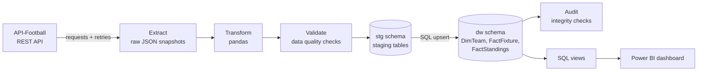

# EPL Analytics: End-to-End ETL Pipeline

An end-to-end data engineering project that pulls English Premier League 2024-25 data from a REST API, validates it, loads it through a staging layer into a dimensional SQL Server warehouse, audits the result, and serves it to a Power BI dashboard.

**Flow:** REST API → Python ETL → SQL Server (staging → warehouse) → Power BI

---

## Why this project

I built this to practise the parts of data engineering that matter beyond "getting data into a table": handling flaky APIs, keeping raw data for replay, validating before loading, loading transactionally, and proving the warehouse is correct after every run.

## Architecture



## Tech stack

| Layer | Tools |
|---|---|
| Source | API-Football v3 (REST, JSON, header-key auth) |
| Pipeline | Python, requests, pandas, pyodbc, python-dotenv |
| Storage | Microsoft SQL Server (T-SQL, `stg` and `dw` schemas) |
| Reporting | Power BI |
| Ops | Python `logging`, `.env` configuration |

## What the pipeline does

1. **Extract:** calls the `teams`, `fixtures` and `standings` endpoints for league 39 (Premier League) and a configurable season. Requests use timeouts and retry with exponential backoff on HTTP 429, 5xx, timeouts and connection errors, and honour the `Retry-After` header. The code also checks the `errors` field in the response body, because the API can return HTTP 200 with an error. Each raw response is saved as a timestamped JSON file so any run can be replayed or debugged.
2. **Transform:** flattens nested JSON into three tidy DataFrames (teams with venue details, fixtures with scores and status, standings), enforces types, and drops duplicate keys.
3. **Validate:** stops the pipeline before any load if a check fails (see below).
4. **Load staging:** refreshes `stg.Teams`, `stg.Fixtures` and `stg.Standings` in a single transaction, verifies row counts inside the transaction, and rolls back on any failure.
5. **Load warehouse:** runs a T-SQL upsert script (`sql/WarehouseLoad.sql`) parameterised by season, wrapped in `TRY/CATCH` with a transaction.
6. **Audit:** runs integrity queries against the warehouse and fails the run if any check does not pass.

## Data quality and audit checks

**Pre-load validation (`src/validate.py`)**
- Datasets are not empty; IDs are not null and are unique
- Home and away teams differ in every fixture
- Every team referenced in fixtures and standings exists in the teams dataset
- Standings arithmetic holds: `points = wins × 3 + draws`, `goal difference = goals for − goals against`, `played = wins + draws + losses`

**Post-load audit (`src/audit.py`)**
- No duplicate team IDs or fixture IDs in the warehouse
- No fixtures pointing to missing teams
- No invalid standings rows
- No duplicate league positions for the season

## Data model

| Schema | Table / View | Purpose |
|---|---|---|
| `stg` | `Teams`, `Fixtures`, `Standings` | Latest extract, refreshed each run |
| `dw` | `DimTeam` | Team and venue dimension |
| `dw` | `FactFixture` | One row per match, foreign keys to `DimTeam` (home and away) |
| `dw` | `FactStandings` | One row per team per season, foreign key to `DimTeam` |
| `dw` | `vw_MatchAnalysis`, `vw_StandingsAnalysis`, `vw_TeamMatchPerformance` | Reporting views used by Power BI |

## Results (2024-25 season run)

| Metric | Result |
|---|---:|
| Teams loaded | 20 |
| Fixtures loaded | 380 |
| Standings records loaded | 20 |
| Duplicate team IDs / fixture IDs | 0 / 0 |
| Fixtures with missing teams | 0 |
| Invalid standings records | 0 |

## Dashboard

<!-- Replace with your own screenshot: save it as docs/dashboard.png and uncomment the line below -->
<!--  -->

The Power BI report (`Final_EPL_Dashboard.pbix`) connects to the warehouse views listed above.

## Project structure

```
EPL_ETL_Project/
├── main.py                  # Orchestrates the full pipeline
├── src/
│   ├── config.py            # Paths, env vars, API and SQL settings
│   ├── extract.py           # API calls, retries, raw JSON snapshots
│   ├── transform.py         # JSON → pandas DataFrames
│   ├── validate.py          # Pre-load data quality checks
│   ├── load_staging.py      # Transactional staging refresh
│   ├── load_warehouse.py    # Runs the warehouse upsert script
│   └── audit.py             # Post-load warehouse audit
├── sql/                     # Database, schemas, tables, upsert, views
├── data/raw/                # Timestamped API responses (git-ignored)
├── logs/                    # pipeline.log (git-ignored)
├── EPL_ETL_PipelineDocumentation.ipynb   # Detailed walkthrough
└── Final_EPL_Dashboard.pbix              # Power BI report
```

## Getting started

**Prerequisites:** Python 3.10+, SQL Server (Express is fine) with SSMS, [ODBC Driver 18 for SQL Server](https://learn.microsoft.com/sql/connect/odbc/download-odbc-driver-for-sql-server), Power BI Desktop, and a free [API-Football](https://www.api-football.com/) key.

1. **Clone and install**
   ```bash
   git clone https://github.com/<your-username>/<your-repo>.git
   cd <your-repo>
   pip install -r requirements.txt
   ```
2. **Configure secrets:** copy `.env.example` to `.env` and fill in your values. Never commit `.env`.
3. **Create the database objects:** run these scripts in SSMS, in this order:
   1. `sql/DB_Creation.sql`
   2. `sql/Create_StagingTable.sql`
   3. `sql/Create_WarehouseTables.sql`
4. **Run the pipeline**
   ```bash
   python main.py
   ```
   `WarehouseLoad.sql` is executed by the pipeline itself.
5. **Create the reporting views:** after the first successful load, run `Create_Match_Analysis_View.sql`, `Create_SpendingsAnalysis_View.sql` (creates `dw.vw_StandingsAnalysis`) and `Create_TeamMatchPerformance_View.sql`.
6. **Open the dashboard:** open `Final_EPL_Dashboard.pbix` in Power BI Desktop and point it at your SQL Server instance.

> **Note:** the free API-Football plan limits request volume and the seasons you can pull. This project uses the 2024 season. Change `SEASON` in `src/config.py` to use another one your plan allows.

## Design decisions

- **Raw JSON is kept before any transformation**, so a bad transform can be fixed and replayed without calling the API again.
- **Validate before load, audit after load.** Bad data is stopped early, and the warehouse is independently checked at the end.
- **Staging and warehouse are separate layers**, so the warehouse is only touched once staged data has passed its checks.
- **Transactions everywhere:** a failed run leaves the previous good data in place.
- **Secrets stay out of code:** the API key and SQL Server details come from `.env`.

## Limitations and next steps

- Orchestration: schedule runs with Airflow or a similar tool instead of manual execution
- Incremental loading: fetch only fixtures that changed, instead of a full season each run
- Automated tests (pytest) for the transform and validation functions
- Containerise with Docker and add a CI workflow on GitHub Actions
- Extend the model with more endpoints (players, match statistics) and multiple seasons

## Author

**Aiswarya C K**: Data Analytics Expert + Mentor
[LinkedIn](https://www.linkedin.com/in/aiswarya-c-k) · [GitHub](https://github.com/DataQuant365)
